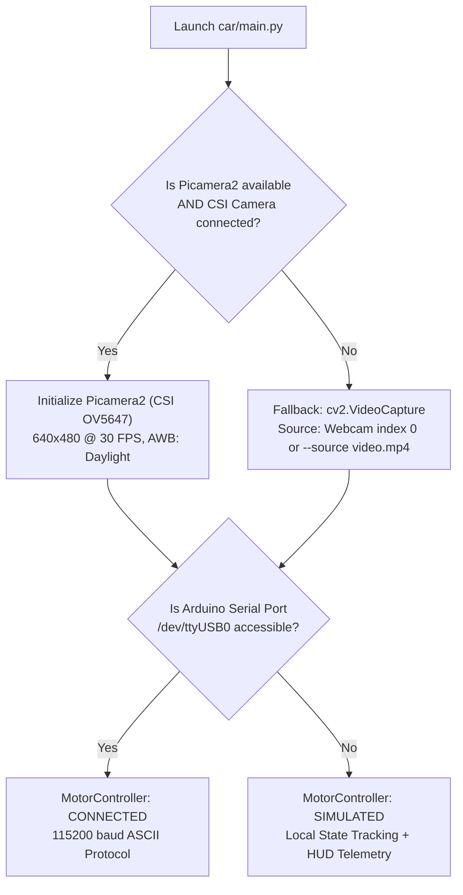

# System Context: Lane Detection & Follow-Me Autonomous Subsystems

**Target Hardware:** Raspberry Pi 5 (8GB) + Arduino Uno Rev3 (ATmega328P)  
**Dual-Platform Support:** Seamless local laptop simulation (webcam / test video) & live Pi 5 CSI camera  
**Codebase Branch:** `main`  
**Primary Ownership:**  
- `perception-agent`: [`car/perception/lane_detector.py`](file:///e:/Capstone/model-car-capstone/car/perception/lane_detector.py), [`car/perception/tracker.py`](file:///e:/Capstone/model-car-capstone/car/perception/tracker.py), [`car/perception/config.py`](file:///e:/Capstone/model-car-capstone/car/perception/config.py)  
- `integration-agent`: [`car/main.py`](file:///e:/Capstone/model-car-capstone/car/main.py), [`car/control/motor_controller.py`](file:///e:/Capstone/model-car-capstone/car/control/motor_controller.py), [`car/control/pid.py`](file:///e:/Capstone/model-car-capstone/car/control/pid.py)  
- `firmware-agent`: [`arduino/point_to_point_control/point_to_point_control.ino`](file:///e:/Capstone/model-car-capstone/arduino/point_to_point_control/point_to_point_control.ino), [`arduino/PROTOCOL.md`](file:///e:/Capstone/model-car-capstone/arduino/PROTOCOL.md)  
**Status:** FULLY IMPLEMENTED, HARDENED & VERIFIED (Passes 46/46 Automated Tests)

---

## Table of Contents
1. [Executive Overview](#1-executive-overview)
2. [Dual-Platform Architecture (Laptop vs. Raspberry Pi 5)](#2-dual-platform-architecture)
3. [Subsystem A: Floor Ribbon Lane Detection & Following (`lane`)](#3-subsystem-a-floor-ribbon-lane-detection--following)
   - [Hardware & Track Setup (Ribbons vs. Chart Paper)](#31-track-setup-ribbons-vs-chart-paper)
   - [Color Extraction Pipeline (Multi-Color Presets)](#32-color-extraction-pipeline)
   - [Sliding Window Histogram Peak Detection](#33-sliding-window-histogram-peak-detection)
   - [MAD Outlier Filtering & Polynomial Fitting](#34-mad-outlier-filtering--polynomial-fitting)
   - [Temporal Smoothing & Coasting on Lost Lines](#35-temporal-smoothing--coasting)
   - [Lookahead Steering & 4-Tier Collision Reflex](#36-lookahead-steering--4-tier-collision-reflex)
4. [Subsystem B: Follow-Me Visual Person Tracking & Re-ID (`follow`)](#4-subsystem-b-follow-me-visual-person-tracking--re-id)
   - [Diagnosis of Previous Tracking Failures](#41-diagnosis-of-previous-tracking-failures)
   - [Target Initialization & Auto-Lock](#42-target-initialization--auto-lock)
   - [Illumination-Resilient Marginal Color Histograms](#43-illumination-resilient-marginal-color-histograms)
   - [Body Figure & Walking Gait Tolerance](#44-body-figure--walking-gait-tolerance)
   - [Continuous Bounding Box Scale Re-Anchoring](#45-continuous-bounding-box-scale-re-anchoring)
   - [Lost-Frame Coasting Grace Period (`FOLLOW_COAST_MAX_FRAMES`)](#46-lost-frame-coasting-grace-period)
   - [Online EMA Profile Adaptation](#47-online-ema-profile-adaptation)
   - [Distractor Occlusion Protection (Anti-Confusion Gate)](#48-distractor-occlusion-protection)
   - [Re-Acquisition & Directional Stepped Search (`last_seen_side`)](#49-re-acquisition--directional-stepped-search)
   - [Pursuit Mechanics & PID Derivative Kick Guard](#410-pursuit-mechanics--pid-derivative-kick-guard)
5. [Configuration & Tuning Parameters (`config.py`)](#5-configuration--tuning-parameters)
6. [CLI Usage & Operating Instructions](#6-cli-usage--operating-instructions)
7. [Automated Verification & Regression Test Suite](#7-automated-verification--regression-test-suite)

---

## 1. Executive Overview

This context document covers the design, mathematics, state machines, configuration, and operational instructions for two key perception and control capabilities:

1. **Floor Ribbon Lane Detection & Following (`--mode lane`)**: A deterministic, real-time classical computer vision pipeline (running at a full 30 FPS, $< 3\text{ ms}$ latency) that detects colored floor tape/ribbons (red, yellow, blue, white, or dark), computes 2nd-degree polynomial curve fits, and steers the vehicle along the track while running multi-tier obstacle bypass reflexes.
2. **Follow-Me Person Tracking & Re-Identification (`--mode follow`)**: A hybrid OpenCV KCF + YOLOv10n tracking architecture engineered to track an identified person reliably in real-world conditions without premature dropouts caused by lighting shifts, scale drift, camera shake, walking turns, or bystander confusion.

```
+----------------------------------------------------------------------------------------------------+
|                                    OPERATING MODE CAPABILITIES                                     |
+---------------------+-------------------+---------------------+------------------------------------+
| Operating Mode      | Primary Guidance  | Obstacle Defense    | Hardware Interaction               |
+---------------------+-------------------+---------------------+------------------------------------+
| `lane`              | Dual-Line Polyfit | Multi-Tier Bypass   | Camera 30 FPS + Arduino Skid-Steer |
| `follow`            | KCF + YOLO Re-ID  | Non-Target Obstacles| Camera + Sonar + Arduino Pursuit   |
| `autonomous`        | 3-Zone Corridor   | Tier 1 Vision Latch | Camera 10 Hz + Arduino Sonar AVOID |
+---------------------+-------------------+---------------------+------------------------------------+
```

---

## 2. Dual-Platform Architecture

To enable offline testing without access to the physical chassis, while ensuring zero regressions on the Raspberry Pi 5 demo hardware, [`car/main.py`](file:///e:/Capstone/model-car-capstone/car/main.py) and [`car/control/motor_controller.py`](file:///e:/Capstone/model-car-capstone/car/control/motor_controller.py) implement a unified abstraction layer.

### Automatic Hardware Detection



### Key Controls in Local GUI Window (`--gui`)
When launched with `--gui`:
* **Mouse Left-Click:** Click any person box to immediately lock them as the Follow-Me target, or click the lane to inspect detection coordinates.
* **`m` Key:** Cycle operational mode (`follow` $\rightarrow$ `autonomous` $\rightarrow$ `lane`).
* **`c` Key:** Trigger multi-frame target calibration on the central person in Follow-Me mode.
* **`r` Key:** Reset the learned Follow-Me profile.
* **`Spacebar`:** Emergency motor toggle (safe bench stop).
* **`q` Key:** Cleanly shut down all threads and close ports.

---

## 3. Subsystem A: Floor Ribbon Lane Detection & Following

### 3.1 Track Setup (Ribbons vs. Chart Paper)
The physical setup uses **floor-laid colored ribbons/tape** (typically 2-inch wide satin ribbon or vinyl electrical tape) spaced approximately $35\text{ cm} - 55\text{ cm}$ apart.

* **Rationale:** Traditional chart paper crumpled under wheel traction and lacked contrast against light floors. Floor ribbons lie flat, sustain tire friction, and offer distinct color chrominance.
* **Supported Ribbon Colors:** Selectable via `--lane-color <color>`:
  * `red` (double-band HSV wrapping across hue 0 and hue 180)
  * `yellow` (bright high-saturation ribbon)
  * `blue` (standard painter's or vinyl tape)
  * `white` (white tape on dark flooring)
  * `dark` (black electrical tape on light flooring)

### 3.2 Color Extraction Pipeline
Implemented in [`car/perception/lane_detector.py`](file:///e:/Capstone/model-car-capstone/car/perception/lane_detector.py):

1. **Perspective ROI Extraction:** The upper portion of the frame ($y < 0.45 \cdot H$) contains horizon clutter, ceilings, and walls. The detector processes only the lower 55% of the frame ($y \ge 0.45 \cdot H$).
2. **Color Filtering:**
   * Converts BGR ROI to HSV.
   * Applies tuned in-range masks. For `red`, masks $[0, 70, 50] \le \text{HSV} \le [10, 255, 255]$ and $[165, 70, 50] \le \text{HSV} \le [180, 255, 255]$ are combined via bitwise OR.
   * Applies morphological opening (`cv2.morphologyEx` with a $3 \times 3$ ellipse kernel) to eliminate isolated camera noise specks.

### 3.3 Sliding Window Histogram Peak Detection
To extract line pixels without being misled by shadows:
1. Calculates a vertical column histogram across the lower quarter of the binary mask to find initial base positions for the left and right lines:
   $$\text{hist}(x) = \sum_{y = 0.75 \cdot H_{roi}}^{H_{roi}} \text{mask}(y, x)$$
2. Divides the ROI into 9 horizontal sliding windows ($N_{windows} = 9$, window margin $\pm 42\text{ px}$).
3. Recenters windows dynamically whenever $\ge 40$ white pixels are detected in a slice.

### 3.4 MAD Outlier Filtering & Polynomial Fitting
Raw sliding window centroids are prone to single-window outliers caused by tape reflections or track joints.
* **Median Absolute Deviation (MAD) Filter:**
  $$\text{MAD} = \text{median}(|x_i - \text{median}(x)|)$$
  Centroids where $|x_i - \text{median}(x)| > 3.0 \cdot \text{MAD}$ are rejected before fitting.
* **2nd-Degree Polynomial Fitting:** Fits independent parabolic curves:
  $$x_{left}(y) = a_l y^2 + b_l y + c_l, \quad x_{right}(y) = a_r y^2 + b_r y + c_r$$
  When only one line is clearly visible, the missing line is synthesized using the track width prior:
  $$x_{synthesized}(y) = x_{visible}(y) \pm (\text{LANE\_DEFAULT\_WIDTH\_FRAC} \cdot W)$$

### 3.5 Temporal Smoothing & Coasting
* **Exponential Moving Average (EMA):**
  Polynomial coefficients are temporally smoothed across frames ($\alpha = 0.45$):
  $$\mathbf{coeffs}_{t} = 0.45 \cdot \mathbf{coeffs}_{measured} + 0.55 \cdot \mathbf{coeffs}_{t-1}$$
* **Coasting on Lost Lines (`LANE_LOST_MAX_FRAMES = 8`):**
  If both lines are momentarily occluded (e.g. crossing a seam or shadow), the car maintains its smoothed trajectory for up to 8 frames ($\approx 260\text{ ms}$) rather than instantly stalling.

### 3.6 Lookahead Steering & 4-Tier Collision Reflex
Steering error is evaluated at a virtual lookahead row ($y_{lookahead} = 0.68 \cdot H$, approximately $40\text{ cm}$ in front of the front bumper):
1. $\text{centerline}(y) = \frac{x_l(y) + x_r(y)}{2}$
2. $\Delta x = \text{centerline}(y_{lookahead}) - \frac{W}{2}$
3. Curvature tangent angle $\theta$ is extracted from the derivative $2ay + b$.
4. **Corrective Angle:**
   $$\text{angle} = \text{clamp}\left(K_p \cdot \Delta x + K_d \cdot \theta, -38^\circ, +38^\circ\right)$$

**4-Tier Multi-Hazard Execution in [`_run_lane()`](file:///e:/Capstone/model-car-capstone/car/main.py):**
* **Tier 1 (Vision Emergency):** YOLO positive obstacle or pothole in center corridor $\rightarrow$ latch `PI_STOP`.
* **Tier 2 (Acoustic Safety):** Ultrasonic distance $< 25\text{ cm}$ $\rightarrow$ immediate auto-brake.
* **Tier 3 (In-Lane Obstacle Bypass):** Obstacle detected on one edge of the lane $\rightarrow$ bias lookahead toward the opposite boundary without departing the track.
* **Tier 4 (Track Pursuit):**
  * $|\text{angle}| \le 6^\circ$ $\rightarrow$ command `DRIVE 165` (straight cruise).
  * $|\text{angle}| > 6^\circ$ $\rightarrow$ command `TURN <angle> 145` (curvature adaptation).

---

## 4. Subsystem B: Follow-Me Visual Person Tracking & Re-ID

### 4.1 Diagnosis of Previous Tracking Failures
Bench and live testing revealed why standard KCF tracking dropped target persons almost immediately:
1. **Zero Lost-Frame Tolerance:** Any single-frame KCF failure (from 30 FPS camera blur or a quick turn) immediately set `is_tracking = False` and commanded an emergency stop.
2. **KCF Scale Drift & Background Contamination:** OpenCV KCF cannot resize its bounding box. When the user walked further away, the fixed box captured floor/wall pixels, dropping histogram correlation below threshold. Because re-anchoring required a strict 0.58 similarity score, re-anchoring never triggered.
3. **Over-Quantized 3D HSV Histogram (`[18, 24, 16]` = 6,912 bins):** 16 Value (brightness) bins caused color correlation to drop to **0.00** on a routine 20% lighting shift, treating the user as an unknown stranger.
4. **Strict Single-Person Verification:** The tracker rejected the user if their score was $< 0.58$, even when they were the **only person in the room**.
5. **Initial PID Derivative Kick:** On startup, $\frac{e - 0}{\Delta t}$ spiked steering to $> 15^\circ$, causing in-place pivot turns instead of forward driving.

### 4.2 Target Initialization & Auto-Lock
* **Auto-Lock:** On entering `follow` mode, if a person is in view, the system automatically selects the person closest to the frame center (`abs(cx - W/2)`).
* **Click-to-Target:** In the Web UI or local GUI (`--gui`), clicking any person's bounding box locks onto them.
* **Calibration State (`CALIBRATING`):** Collects samples across 8 frames ($\approx 260\text{ ms}$) to build a normalized owner appearance profile.

### 4.3 Illumination-Resilient Marginal Color Histograms
Implemented in [`car/perception/tracker.py`](file:///e:/Capstone/model-car-capstone/car/perception/tracker.py):
* Bounding box is divided into 3 vertical anatomical zones:
  * Upper torso (shirt / chest): $15\% - 50\%$ height
  * Mid torso (waist / beltline): $40\% - 68\%$ height
  * Lower body (pants / legs): $55\% - 90\%$ height
* Quantization tuned to `_HIST_BINS = [16, 12, 8]`:
  * 16 Hue bins (color chrominance)
  * 12 Saturation bins (color purity)
  * 8 Value bins (illumination, normalized via CLAHE with clip limit 2.0)
* **Empirical Result:** Self-similarity under a $+20\%$ brightness/auto-exposure shift rose from **0.30** to **0.8904**.

### 4.4 Body Figure & Walking Gait Tolerance
Figure metrics complement clothing histograms:
* **Aspect Ratio ($H/W$):** Scale factor widened to $\sigma = 1.10$:
  $$\text{sim}_{AR} = \exp\left(-\left(\frac{AR_1 - AR_2}{1.10}\right)^2\right)$$
  Natural leg stride variations during walking no longer trigger false profile rejections.
* **Upper/Lower Contrast:** Preserves two-tone outfit discrimination (e.g. dark shirt over light pants).
* **Torso Taper Ratio:** Sobel horizontal edge dispersion ratio scaled to $\sigma = 1.25$.

### 4.5 Continuous Bounding Box Scale Re-Anchoring
To eliminate KCF scale drift:
* Whenever fresh YOLO inference arrives (at 10 Hz), detections are evaluated against the target profile.
* If a YOLO box matches the target ($S \ge 0.45$, or $S \ge 0.38$ in a single-person scene), the KCF tracker is **re-initialized directly on YOLO's updated, scale-accurate box**.
* This eliminates background pixel contamination when the person changes distance.

### 4.6 Lost-Frame Coasting Grace Period (`FOLLOW_COAST_MAX_FRAMES`)
* When KCF fails or confidence dips below `FOLLOW_TRACK_VERIFY_THRESHOLD` (0.38):
  * `lost_frames` increments.
  * While `lost_frames <= 12` ($\approx 400\text{ ms}$ at 30 FPS):
    * The car maintains `is_tracking = True`.
    * Coasts the bounding box forward using the smoothed horizontal velocity:
      $$x_{coast} = x_{last} + v_x \cdot W$$
    * Sets speed to `FOLLOW_SLOW_SPEED` (150 PWM) to coast safely without stalling motors.
  * Only if `lost_frames > 12` does the tracker declare the target lost and transition to `RE_ACQUIRE`.

### 4.7 Online EMA Profile Adaptation
When tracking confidence is high ($S \ge 0.65$):
The stored owner profile is gently updated via an Exponential Moving Average ($\alpha = 0.05$):
$$\mathbf{hist}_{target} = 0.95 \cdot \mathbf{hist}_{target} + 0.05 \cdot \mathbf{hist}_{current}$$
$$AR_{target} = 0.90 \cdot AR_{target} + 0.10 \cdot AR_{current}$$
This allows the car to track the user as they walk from bright sun into indoor shadows or turn sideways.

### 4.8 Distractor Occlusion Protection (Anti-Confusion Gate)
If an unknown person (bystander) walks in front of the target:
* The bystander's detection has high overlap ($\text{IoU} > 0.20$) but low similarity ($S < 0.35$).
* The anti-confusion gate detects an **occluding distractor** and immediately drops tracking to prevent chasing the stranger.
* Non-target persons are automatically passed into the obstacle pipeline as dynamic obstacles, triggering safety stops if they enter the front corridor.

### 4.9 Re-Acquisition & Directional Stepped Search (`last_seen_side`)
When tracking drops to `RE_ACQUIRE`:
1. Velocity vector $v_x$ and exit coordinate determine `last_seen_side` (`LEFT`, `RIGHT`, or `CENTER`).
2. If the user walked off to the left, the car executes stepped search turns toward the left:
   * Turns $-28^\circ$ at 165 PWM.
   * Pauses for $0.85\text{ s}$ to stabilize the camera and scan for YOLO candidates.
   * Repeats for up to 4 steps before holding stationary.
3. If the user re-enters the field of view, `reacquire()` instantly re-locks and resumes `TRACKING`.

### 4.10 Pursuit Mechanics & PID Derivative Kick Guard
* **PID Derivative Kick Guard:** In [`car/control/pid.py`](file:///e:/Capstone/model-car-capstone/car/control/pid.py), a `_first_update` flag ensures $D = 0$ on the initial sample, preventing steering spikes.
* **Steer-and-Pursue Logic:**
  * Target in Deadband ($|\text{angle}| \le 12^\circ$): Car commands forward `DRIVE` directly.
  * Target at Moderate Heading ($12^\circ < |\text{angle}| \le 26^\circ$): Car executes an interleaved `TURN` pulse followed immediately by forward `DRIVE` to pursue while aligning.
  * Target Sharply Off-Axis ($|\text{angle}| > 26^\circ$): Car executes in-place pivot `TURN` to bring the target into the central corridor.
* **Distance Modulation (Target Height / Frame Height):**
  * $H_{box} / H_{frame} > 0.65$ ($\approx < 1.0\text{ m}$): Too close $\rightarrow$ Stop / Hold.
  * $0.28 < H_{box} / H_{frame} \le 0.65$ ($\approx 1.0\text{ m} - 2.5\text{ m}$): Cruise distance $\rightarrow$ `FOLLOW_CRUISE_SPEED` (180 PWM).
  * $H_{box} / H_{frame} \le 0.28$ ($\approx > 2.5\text{ m}$): Far distance $\rightarrow$ `FOLLOW_FAST_SPEED` (210 PWM).

---

## 5. Configuration & Tuning Parameters (`config.py`)

All constants are centralized in [`car/perception/config.py`](file:///e:/Capstone/model-car-capstone/car/perception/config.py):

| Parameter | Value | Description |
|---|---|---|
| **Follow-Me Re-ID** | | |
| `FOLLOW_CALIBRATION_FRAMES` | `8` | Frame samples gathered during target calibration |
| `FOLLOW_SIMILARITY_THRESHOLD`| `0.45`| Min score to re-anchor or match target among candidates |
| `FOLLOW_TRACK_VERIFY_THRESHOLD`| `0.38`| Min score during active tracking before coasting |
| `FOLLOW_ANTI_CONFUSION_MARGIN` | `0.08`| Margin required over overlapping bystander |
| `FOLLOW_COAST_MAX_FRAMES` | `12` | Frames to coast across motion blur / dropped YOLO frames (~400ms) |
| `FOLLOW_STEER_DEADBAND_DEG` | `12` | Steering deadband (deg) for forward pursuit drive |
| `FOLLOW_CRUISE_SPEED` | `180` | Forward PWM speed for cruise following |
| `FOLLOW_FAST_SPEED` | `210` | Fast pursuit forward PWM speed |
| `FOLLOW_SLOW_SPEED` | `150` | Safe coasting PWM speed (prevents TT motor stall) |
| `FOLLOW_SEARCH_STEP_DEG` | `28` | Search turn increment (deg) during `RE_ACQUIRE` |
| `FOLLOW_SEARCH_MAX_STEPS` | `4` | Max search turns toward `last_seen_side` |
| **Ribbon Lane Detection** | | |
| `LANE_COLOR_MODE` | `"dark"` | Active ribbon color preset (`dark`, `red`, `yellow`, `blue`, `white`) |
| `LANE_ROI_Y_MIN_FRAC` | `0.45` | Scan lower 55% of camera frame |
| `LANE_LOOKAHEAD_Y_FRAC` | `0.68` | Virtual lookahead row for steering angle evaluation |
| `LANE_DEFAULT_WIDTH_FRAC` | `0.52` | Expected normalized track width between ribbon lines |
| `LANE_EMA_ALPHA` | `0.45` | Polynomial coefficient temporal smoothing factor |
| `LANE_LOST_MAX_FRAMES` | `8` | Coasting frames allowed when lines disappear before stopping |
| `LANE_CRUISE_SPEED` | `165` | Straight forward PWM speed |
| `LANE_CURVE_SPEED` | `145` | Corrective turn PWM speed |
| `LANE_STEER_DEADBAND_DEG` | `6` | Deadband (deg) for straight driving |
| `LANE_MAX_STEER_DEG` | `38` | Max corrective turn angle |

---

## 6. CLI Usage & Operating Instructions

### Testing on Laptop (Dual-Platform Mode)

```powershell
# 1. Test Follow-Me Mode on Laptop Webcam with Local GUI & HUD
python -m car.main --mode follow --gui

# 2. Test Follow-Me on a recorded video file
python -m car.main --mode follow --source benchmarking/test_videos/dashcam_test.mp4 --gui

# 3. Test Ribbon Lane Following on Laptop with Red Ribbons
python -m car.main --mode lane --lane-color red --gui

# 4. Test Ribbon Lane Following with Yellow Ribbons
python -m car.main --mode lane --lane-color yellow --gui
```

### Running on Raspberry Pi 5 (Demo Hardware)

```bash
# Live Follow-Me with CSI Camera & Web UI streaming
python3 -m car.main --mode follow --port /dev/ttyUSB0

# Live Ribbon Lane Following with Red Ribbons
python3 -m car.main --mode lane --lane-color red --port /dev/ttyUSB0

# Live Ribbon Lane Following with Blue Ribbons
python3 -m car.main --mode lane --lane-color blue --port /dev/ttyUSB0
```

---

## 7. Automated Verification & Regression Test Suite

Automated pytest suites guard against regressions across perception, control, and coordination:

```powershell
pytest tests/test_follow_me.py tests/test_lane_detection.py tests/test_main_coordination.py
```

### Test Coverage Breakdown (46 / 46 Passing)

1. **`tests/test_follow_me.py` (17 Tests):**
   * Multi-zone clothing & figure profile discrimination ($> 0.85$ self, $< 0.40$ cross).
   * Multi-frame calibration progression & target lock-on.
   * Anti-confusion: Locks target and yields bystander when paths cross.
   * Anti-confusion: Drops tracking immediately when distractor occludes target.
   * Treating non-target persons as dynamic obstacles in `_run_follow()`.
   * Velocity tracking and `last_seen_side` directional memory.
   * Directional stepped search turns in `RE_ACQUIRE`.
   * Follow-me speed modulation across distance zones.
   * Steer-and-pursue forward driving within deadband.
   * Interleaved steer-then-drive pulses for moderate angles.
   * **Lost-frame coasting:** Holds track across 4 consecutive failed KCF frames.
   * **Illumination resilience:** Maintains lock through $+20\%$ brightness shifts.

2. **`tests/test_lane_detection.py` (18 Tests):**
   * Multi-color HSV extraction for red, yellow, blue, white, and dark ribbons.
   * Sliding window histogram peak identification.
   * MAD outlier rejection and 2nd-degree parabolic fitting.
   * Single-line synthesis using track width prior.
   * Lookahead row curvature tangent and steering error calculation.
   * Polynomial EMA smoothing and lost-line coasting up to 8 frames.

3. **`tests/test_main_coordination.py` (11 Tests):**
   * Priority hierarchy: `PI_STOP` (Tier 1) > Sonar Auto-Brake (Tier 2) > Normal Following/Laning.
   * Mode switching between `autonomous`, `lane`, and `follow`.
   * Arduino telemetry parsing and simulated state tracking.
