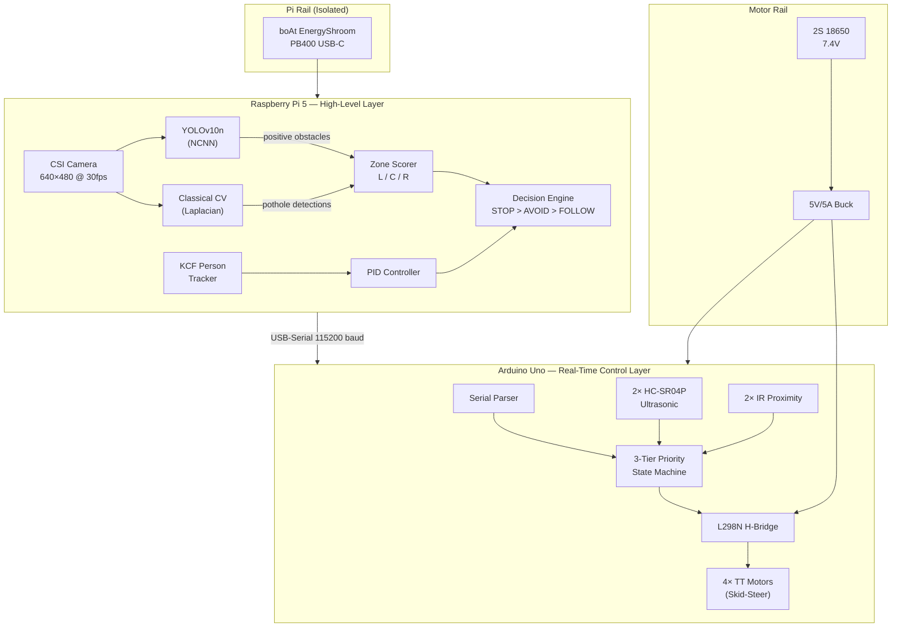
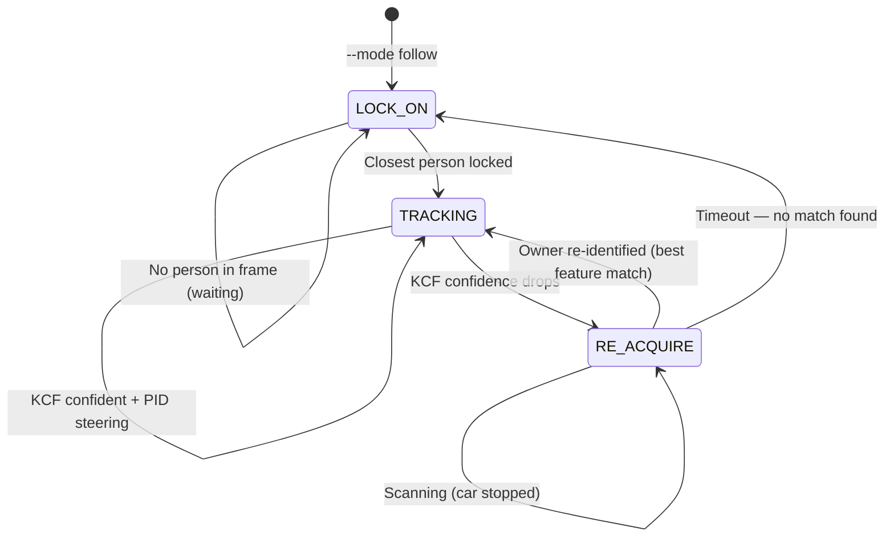
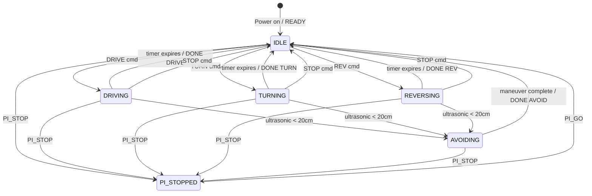
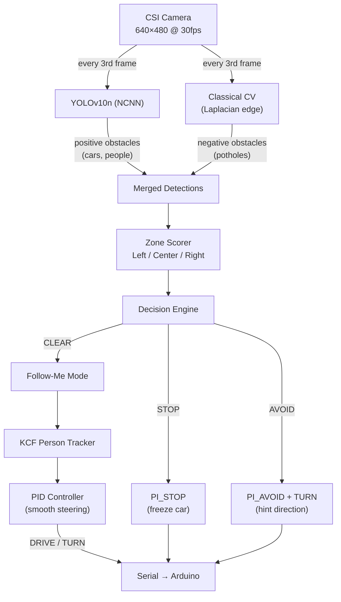

# System Architecture — Autonomous Follow-Me RC Car

**Status**: FINAL / APPROVED  
**Date**: 2026-09-29  
**Owner**: `docs-tracker-agent` (Krishna lead)  
**Target Hardware**: Arduino Uno (ATmega328P) + Raspberry Pi 5 (8GB)

---

> [!IMPORTANT]
> **This canonical architecture reconciles hardware baselines, firmware contracts, and high-level perception:**
> - [arduino_rf_robot_pin_configuration_wiring_guide.md](file:///e:/OneDrive%20-%20Shri%20Vile%20Parle%20Kelavani%20Mandal/Capstone/model/arduino_rf_robot_pin_configuration_wiring_guide.md) — **physical hardware baseline** (as currently wired)
> - [docs/scenarios/](file:///e:/OneDrive%20-%20Shri%20Vile%20Parle%20Kelavani%20Mandal/Capstone/model/docs/scenarios) — 10 behavioral scenario specifications
> - [arduino/PROTOCOL.md](file:///e:/OneDrive%20-%20Shri%20Vile%20Parle%20Kelavani%20Mandal/Capstone/model/arduino/PROTOCOL.md) — authoritative serial command/telemetry protocol

> [!WARNING]
> ### Pending Hardware Change: PWM Migration
>
> **ENA/ENB are currently jumpered to 5V** — motors run at full speed only (no PWM control). This blocks PID steering, speed modulation, and avoidance speed differentiation. A **4-wire swap** is required to enable PWM (see Section 3).
>
> **The hardware has NOT been changed yet.** The pin tables below document both the current wiring and the target wiring after the migration.

---

## 1. System Overview



### Two-Layer Split

| Layer | Hardware | Responsibility |
|---|---|---|
| **High-Level (Brain)** | Raspberry Pi 5 | Perception (YOLO + classical CV), person tracking, PID steering, navigation planning, decision engine |
| **Real-Time (Spine)** | Arduino Uno (ATmega328P) | Motor PWM, ultrasonic polling, local avoidance reflex, serial protocol, state machine |

### Why Two Layers?

| Concern | Pi 5 Alone | Pi 5 + Arduino |
|---|---|---|
| PWM Timing | Jittery under YOLO load (~50ms GPIO latency) | Rock-solid hardware timer (~4µs) |
| Safety | Pi crash = car keeps going | Arduino stops motors independently |
| Complexity | Everything fights for CPU | Clean separation of concerns |
| Testability | Need full stack to test motors | Arduino testable standalone via Serial Monitor |

> [!NOTE]
> **Future scope**: Arduino Uno → Nano migration (same ATmega328P, drop-in, zero code changes). Don't write Uno-only assumptions (e.g., shield stacking) that would block this.

---

## 2. Power Architecture

```text
  MOTOR RAIL (shared ground)               PI RAIL (isolated)
  ========================                  ==================

  +------------------+                     +------------------+
  | 2S 18650 Battery |                     | boAt EnergyShroom|
  |   7.4V nominal   |                     |   PB400 (USB-C)  |
  +--------+---------+                     +--------+---------+
           |                                        |
           v                                        v
  +--------+---------+                     +--------+---------+
  | 5V/5A Buck Conv. |                     | Raspberry Pi 5   |
  +--------+---------+                     +------------------+
           |
     +-----+-----+
     |           |
     v           v
  +--+---+  +---+----------+
  |L298N |  | Arduino Uno  |
  |Motor |  +------+-------+
  |Driver|         |
  +------+    +----+----+
              | 16-pin  |
              |Berg Strip|
              +----+----+
                   |
        +----------+----------+
        |          |          |
        v          v          v
    US1 + US2   IR1 + IR2   L298N
    (5V/GND)    (5V/GND)    Logic
```

**Key design decisions:**
- **Isolated Pi power** — The Pi 5 draws up to 5A under load. A dedicated USB-C power bank eliminates motor back-EMF noise coupling into the Pi's power rail.
- **Common ground** — Tied only at the serial/logic interface to ensure signal integrity.
- **Berg strip** — 16-pin male header splits into 8× 5V and 8× GND for clean sensor power distribution.

**Berg Strip Distribution (16-pin):**

| 5V Rail | GND Rail |
|---|---|
| Pin 1: Arduino 5V Out | Pin 1: Arduino GND |
| Pin 2: Ultrasonic 1 VCC | Pin 2: Ultrasonic 1 GND |
| Pin 3: Ultrasonic 2 VCC | Pin 3: Ultrasonic 2 GND |
| Pin 4: IR Sensor 1 VCC | Pin 4: IR Sensor 1 GND |
| Pin 5: IR Sensor 2 VCC | Pin 5: IR Sensor 2 GND |
| Pin 6: L298N Logic VCC | Pin 6: L298N GND |
| Pin 7: Spare | Pin 7: Spare |
| Pin 8: Spare | Pin 8: Spare |

---

## 3. Arduino Pin Assignment

### 3a. Current Hardware Wiring (as-built per RF guide)

> [!CAUTION]
> **This is what's physically wired RIGHT NOW.** ENA/ENB are jumpered to 5V — no speed control. D5/D6 are used for ultrasonic trig/echo, wasting PWM-capable pins on signals that don't need PWM.

| Pin | Current Function | Dir | Subsystem | Notes |
|:---:|---|:---:|---|---|
| D2 | IR Sensor 1 | IN | IR proximity | Digital HIGH/LOW |
| D3 | IR Sensor 2 | IN | IR proximity | Interrupt-capable |
| D4 | Ultrasonic 1 Echo | IN | HC-SR04P front-left | Pulse timing |
| D5 | Ultrasonic 1 Trigger | OUT | HC-SR04P front-left | ⚠️ PWM pin wasted on digital output |
| D6 | Ultrasonic 2 Echo | IN | HC-SR04P front-right | ⚠️ PWM pin wasted on digital input |
| D7 | Ultrasonic 2 Trigger | OUT | HC-SR04P front-right | 10µs pulse |
| D8 | Motor IN1 | OUT | L298N | Left direction bit 1 |
| D9 | Motor IN2 | OUT | L298N | Left direction bit 2 |
| D10 | Motor IN3 | OUT | L298N | Right direction bit 1 |
| D11 | Motor IN4 | OUT | L298N | Right direction bit 2 |
| D12 | — | — | Free | Available |
| D13 | — | — | Free | Built-in LED |
| ENA | Jumpered to 5V | — | L298N Ch.A | ❌ Full speed only, no PWM |
| ENB | Jumpered to 5V | — | L298N Ch.B | ❌ Full speed only, no PWM |

### 3b. Target Wiring (after PWM migration)

> [!IMPORTANT]
> **This is the target pin map.** It requires a 4-wire physical swap (described below). [`pins.h`](file:///e:/OneDrive%20-%20Shri%20Vile%20Parle%20Kelavani%20Mandal/Capstone/model/arduino/lib/pins.h) must be updated to match once the hardware change is done.

| Pin | Target Function | Dir | Subsystem | Notes |
|:---:|---|:---:|---|---|
| D2 | IR Sensor 1 | IN | IR proximity | Digital HIGH/LOW (may be scrapped) |
| D3 | IR Sensor 2 | IN | IR proximity | Interrupt-capable (may be scrapped) |
| D4 | Ultrasonic 1 Echo | IN | HC-SR04P front-left | Unchanged |
| **D5** | **ENA — Left Motor PWM** | **OUT** | **L298N Ch.A** | **Timer0 PWM (0–255)** |
| **D6** | **ENB — Right Motor PWM** | **OUT** | **L298N Ch.B** | **Timer0 PWM (0–255)** |
| D7 | Ultrasonic 2 Trigger | OUT | HC-SR04P front-right | Unchanged |
| D8 | Motor IN1 | OUT | L298N | Left direction bit 1 |
| D9 | Motor IN2 | OUT | L298N | Left direction bit 2 |
| D10 | Motor IN3 | OUT | L298N | Right direction bit 1 |
| D11 | Motor IN4 | OUT | L298N | Right direction bit 2 |
| **D12** | **Ultrasonic 1 Trigger** | **OUT** | **HC-SR04P front-left** | **← moved from D5** |
| **D13** | **Ultrasonic 2 Echo** | **IN** | **HC-SR04P front-right** | **← moved from D6** (LED flickers, cosmetic) |

> [!IMPORTANT]
> **ENA and ENB MUST be wired to D5/D6** — never jumpered to 5V. Jumpering locks motors at full speed, disabling PWM control entirely. PID steering and avoidance speed modulation both depend on variable PWM.

### 3c. PWM Migration — 4-Wire Swap Procedure

> [!NOTE]
> **Hardware not changed yet.** This section documents the planned swap. All changes are reversible (no cutting, no soldering). Perform with the car powered off.

| Step | Action | Detail |
|:---:|---|---|
| 1 | Unplug US1 Trigger from **D5** → plug into **D12** | Frees D5 for PWM |
| 2 | Unplug US2 Echo from **D6** → plug into **D13** | Frees D6 for PWM |
| 3 | Remove **ENA jumper clip** → wire ENA to **D5** (F-to-M) | Enables PWM speed control for left motor channel |
| 4 | Remove **ENB jumper clip** → wire ENB to **D6** (F-to-M) | Enables PWM speed control for right motor channel |

After completing the swap, update [`pins.h`](file:///e:/OneDrive%20-%20Shri%20Vile%20Parle%20Kelavani%20Mandal/Capstone/model/arduino/lib/pins.h) to match the target pin map.

---

## 4. Sensor Layout

```text
                    FRONT OF CAR
          ______________________________
         |                              |
         |   [US1]              [US2]   |    US1 = Front-Left  HC-SR04P
         |     \                /       |    US2 = Front-Right HC-SR04P
         |      \   coverage   /        |
         |       \   cone    /          |    Coverage: ~15° each
         |        \        /            |    Combined: ~60° forward cone
         |         \      /             |    Range: 2cm – 340cm
         |          \    /              |    Threshold: < 20cm triggers avoidance
         |           \  /               |
         |            \/                |
         |                              |
         |  [IR1]    [CAM]    [IR2]     |    IR1 = D2, IR2 = D3 (likely scrapped)
         |           (CSI)              |    CAM = CSI Global Shutter (center)
         |                              |
         |  [FL]      [FR]              |    4× TT Motors (skid-steer)
         |  [RL]      [RR]              |    Left pair:  Ch.A (ENA/IN1/IN2)
         |______________________________|    Right pair: Ch.B (ENB/IN3/IN4)

                    REAR OF CAR
```

**Sensor capabilities & blind spots:**

| Sensor | Detects | Cannot Detect | Status |
|---|---|---|---|
| HC-SR04P (×2) | Walls, solid obstacles, furniture, people (at close range) | Potholes, drop-offs, cliff edges, thin obstacles | ✅ Active |
| IR proximity (×2) | Ground-level obstacles, line edges | Anything above sensor height | ⚠️ Attached, likely to be scrapped |
| CSI Camera + YOLO | People, cars, potholes, general objects | Obstacles outside field of view, behind the car | ✅ Active |

---

## 5. Operating Modes

The car supports two operating modes, selected at launch. The mode determines how the Pi's decision engine interprets detections and commands the Arduino.

### Mode Selection

Set at launch via CLI flag:

```bash
# Autonomous navigation — avoid obstacles, navigate path
python car/main.py --mode autonomous

# Follow-me — lock onto a specific person and follow them
python car/main.py --mode follow
```

> [!NOTE]
> **Future option (parked):** If the IR sensors are retained instead of scrapped, an IR remote could send mode-switch signals at runtime. This would require adding an IR receiver decoder to the Arduino firmware and forwarding mode commands over serial. Low priority for now.

### Mode Comparison

| Aspect | Autonomous Navigation | Follow-Me |
|---|---|---|
| **Goal** | Drive ahead / waypoints, avoid obstacles | Track and follow a specific target person |
| **Person detection** | Person = obstacle → stop / avoid | Person = target → follow |
| **PI_STOP triggers** | Close obstacle + heading toward it | Target lost (KCF fails), or non-target obstacle close |
| **Speed control** | Fixed PWM from DRIVE commands | Dynamic — modulated by target distance |
| **Ultrasonic avoidance** | Active (Tier 2) | Active (Tier 2) — car still reflexes around obstacles |

### Follow-Me Pipeline



**Phase 1 — Lock-On (startup):**
Car is `IDLE`, camera running. YOLO detects all persons in frame. The car selects the **closest** person (largest bounding box) and:
1. Extracts appearance features (see table below)
2. Stores them as the **"owner profile"**
3. Initializes the KCF tracker on that bounding box
4. Commences tracking

**Phase 2 — Tracking (steady state):**
KCF tracks the owner frame-to-frame (fast, ~1ms per frame on Pi 5). PID controller adjusts steering to keep the target centered in the frame. Forward speed is dynamically modulated based on bounding box height:

| Target bbox height (% of frame) | Meaning | Speed response |
|---|---|---|
| > 50% | Too close | Slow down / stop |
| 25–50% | Ideal following distance | Cruise speed |
| 10–25% | Getting far | Speed up |
| < 10% | Very far / losing them | Max speed, prepare for re-acquisition |

**Phase 3 — Re-Acquisition (target lost):**
When KCF confidence drops below threshold (e.g. target occluded, quick turn, temporary out of frame):
1. Send `PI_STOP` (freeze in place)
2. Switch to full-frame YOLO person scanning
3. Compare **every detected person's** features against the stored owner profile
4. Best match above similarity threshold → re-lock KCF, send `PI_GO`, resume following
5. No match found after timeout → return to lock-on phase (wait for owner to re-enter)

### Appearance Features (Owner Profile)

Extracted from the YOLO bounding box during lock-on and used for re-identification. Lightweight numpy histogram operations without neural re-ID overhead:

| Feature | Extraction | Why It Helps |
|---|---|---|
| **Upper body color histogram** | HSV histogram of top 40% of bbox | Shirt / jacket color |
| **Lower body color histogram** | HSV histogram of bottom 40% of bbox | Pants / shorts color |
| **Height-to-width ratio** | Aspect ratio of bbox | Body build differentiation |
| **Relative size** | Last-known bbox area | Distance sanity check for re-ID |

**Comparison method:** Histogram correlation (OpenCV `cv2.compareHist`) between stored owner profile and each candidate person. Highest correlation score above threshold = owner.

> [!WARNING]
> **Limitations:**
> - Changing clothes mid-session will break re-identification (appearance-based, not facial biometrics)
> - Designed for distinguishing 2–4 people in frame; degraded performance in dense crowds
> - Significant lighting shifts (indoor fluorescent → harsh sunlight) can alter color histograms; HSV hue channel mitigates this
> - Heavy face-recognition models were evaluated and rejected due to real-time latency budget on the Pi 5 alongside YOLOv10n

---

## 6. Three-Tier Priority Stack

This is the core behavioral contract of the system. Every decision the car makes flows through this priority hierarchy.

```text
  PRIORITY        TIER              WHO CONTROLS         WHAT HAPPENS
  ═══════════════════════════════════════════════════════════════════════

  HIGHEST    ┌──────────────────┐
             │ TIER 1           │   Pi 5 (camera)       All motors FROZEN.
             │ Pi Camera Latch  │   PI_STOP / PI_GO     Only PI_GO releases.
             │                  │   PI_AVOID hint       Direction hint stored.
             └────────┬─────────┘
                      │  overrides
                      ▼
             ┌──────────────────┐
             │ TIER 2           │   Arduino (local)     3-phase avoidance:
             │ Ultrasonic       │   Autonomous reflex   1. Reverse (configurable)
             │ Avoidance        │   < 20cm triggers     2. Turn (configurable)
             └────────┬─────────┘                       3. Resume fwd (configurable)
                      │  overrides
                      ▼
  LOWEST     ┌──────────────────┐
             │ TIER 3           │   Pi 5 (commands)     Standard timed
             │ Normal Driving   │   DRIVE/TURN/REV      motor actions.
             │ Follow-Me PID   │   STOP/PING           PID steering loop.
             └──────────────────┘
```

**Priority rules:**
1. **Tier 1 overrides everything.** `PI_STOP` instantly freezes all motors, even mid-avoidance maneuver. Only `PI_GO` releases the latch.
2. **Tier 2 overrides Tier 3.** If ultrasonics detect < 20cm during any movement (forward, reverse, or turn), avoidance triggers immediately, cancelling the current Tier 3 command.
3. **Tier 3 commands replace, not queue.** A new `DRIVE` replaces the old `DRIVE` immediately. No command buffer.
4. **`PI_AVOID` is a stored hint.** It overrides the Arduino's turn direction decision during the next Tier 2 avoidance, then clears. Last hint wins if multiple are sent.

### PI_STOP Decision Rules (Pi-Side Logic)

`PI_STOP` is **not** a blanket "person detected → freeze" trigger. The Pi's decision engine must consider **direction of travel**, **distance**, and **operating mode** before issuing a stop.

**Rule 1 — Direction-awareness:**
The Pi knows the car's current state from Arduino telemetry (`STATE=DRIVING`, `STATE=REVERSING`, etc.). It must only stop when the car is **heading toward** the threat.

| Car state | Camera sees threat ahead | Action |
|---|---|---|
| DRIVING (forward) | Yes | Evaluate distance (Rule 2) |
| REVERSING (backward) | Yes | **Ignore** — car is moving away from it |
| TURNING | Yes | Evaluate distance (Rule 2) |
| IDLE | Yes | **Ignore** — car isn't moving |

**Rule 2 — Distance-awareness (bounding box proxy):**
YOLO bounding box height as a percentage of frame height is used as a distance proxy. No LIDAR needed.

| Box height (% of frame) | Proximity | Action |
|---|---|---|
| < 15% | Far away | Continue driving, keep monitoring |
| 15–40% | Approaching | Reduce speed (lower PWM in next DRIVE cmd) |
| > 40% | Close / imminent | **PI_STOP** |

> [!NOTE]
> Initial threshold values (15%, 40%) are starting baselines. Calibrate on the physical chassis by measuring box height against known distance benchmarks.

**Rule 3 — Mode-awareness:**
The response to a detected person depends on the car's active operating mode.

| Mode | Person detected | Behavior |
|---|---|---|
| **Follow-me** | Person = **tracking target** | Follow them (KCF tracker + PID). Never PI_STOP for your target. |
| **Follow-me** | Target lost (KCF fails) | Stop, re-acquire via YOLO owner profile |
| **Follow-me** | Second person / non-target | Evaluate as obstacle (Rules 1 & 2) |
| **Autonomous nav** | Person = **obstacle** | Apply Rules 1 & 2, stop if close + heading toward |

> [!IMPORTANT]
> **Camera blind spot:** The CSI camera faces forward. The car has **zero rear visibility**. During reverse maneuvers, neither the camera nor the front-facing ultrasonics can detect obstacles behind the car. The current mitigation is that reverses are short (400ms at PWM 150) and low-force. A rear ultrasonic sensor is a future scope candidate if D2/D3 are freed by scrapping the IR sensors.

---

## 7. Arduino State Machine



**Avoidance sub-phases (Tier 2):**

All durations are configurable via named constants in [`protocol.h`](file:///e:/OneDrive%20-%20Shri%20Vile%20Parle%20Kelavani%20Mandal/Capstone/model/arduino/lib/protocol.h):

| Phase | Duration (default) | Config Constant | Left Motors | Right Motors | Purpose |
|---|---|---|---|---|---|
| 1. Reverse | 400ms | `AVOID_REVERSE_MS` | PWM 150 backward | PWM 150 backward | Back away from obstacle |
| 2. Skid-turn | 500ms | `AVOID_TURN_MS` | ±150 | ∓150 | Turn away (sensor or PI_AVOID hint) |
| 3. Resume forward | 2000ms | `AVOID_RESUME_MS` | PWM at saved speed | PWM at saved speed | Continue on new heading |
| — | — | `AVOID_SPEED` | 150 | 150 | PWM speed for phases 1 & 2 |

---

## 8. Pi 5 Software Data Flow



**Pi 5 software modules:**

| Module | File | Purpose |
|---|---|---|
| Entry Point | [`car/main.py`](file:///e:/OneDrive%20-%20Shri%20Vile%20Parle%20Kelavani%20Mandal/Capstone/model/car/main.py) | Camera → Detect → Decide → Drive loop |
| YOLO Detector | [`car/perception/detector.py`](file:///e:/OneDrive%20-%20Shri%20Vile%20Parle%20Kelavani%20Mandal/Capstone/model/car/perception/detector.py) | YOLOv10n NCNN + pothole classical CV |
| Avoidance Engine | [`car/perception/avoidance.py`](file:///e:/OneDrive%20-%20Shri%20Vile%20Parle%20Kelavani%20Mandal/Capstone/model/car/perception/avoidance.py) | Zone scoring L/C/R + decision logic |
| Person Tracker | [`car/perception/tracker.py`](file:///e:/OneDrive%20-%20Shri%20Vile%20Parle%20Kelavani%20Mandal/Capstone/model/car/perception/tracker.py) | OpenCV KCF tracker for follow-me |
| Sensor Manager | [`car/perception/sensors.py`](file:///e:/OneDrive%20-%20Shri%20Vile%20Parle%20Kelavani%20Mandal/Capstone/model/car/perception/sensors.py) | Parses Arduino ultrasonic telemetry |
| Config | [`car/perception/config.py`](file:///e:/OneDrive%20-%20Shri%20Vile%20Parle%20Kelavani%20Mandal/Capstone/model/car/perception/config.py) | Camera, model paths, serial port, thresholds |
| Motor Controller | [`car/control/motor_controller.py`](file:///e:/OneDrive%20-%20Shri%20Vile%20Parle%20Kelavani%20Mandal/Capstone/model/car/control/motor_controller.py) | Serial bridge to Arduino |
| PID Controller | [`car/control/pid.py`](file:///e:/OneDrive%20-%20Shri%20Vile%20Parle%20Kelavani%20Mandal/Capstone/model/car/control/pid.py) | Smooth proportional steering |
| Navigation | [`car/control/navigation.py`](file:///e:/OneDrive%20-%20Shri%20Vile%20Parle%20Kelavani%20Mandal/Capstone/model/car/control/navigation.py) | Dead-reckoning waypoint driving |

---

## 9. Communication Protocol

**Source of truth**: [`arduino/PROTOCOL.md`](file:///e:/OneDrive%20-%20Shri%20Vile%20Parle%20Kelavani%20Mandal/Capstone/model/arduino/PROTOCOL.md)

| Property | Value |
|---|---|
| Baud Rate | **115200**, 8-N-1 |
| Transport | **USB-Serial** (`/dev/ttyUSB0`) — Pi 5 USB-A to Arduino USB-B cable |
| Line Ending | `\n` (newline) |
| Telemetry prefix | `[TELEM]` |
| Acknowledge prefix | `[ACK]` |

### Commands (Pi → Arduino)

| Tier | Command | Format | Description |
|:---:|---|---|---|
| 1 | PI_STOP | `PI_STOP` | Latched emergency stop — freezes everything |
| 1 | PI_GO | `PI_GO` | Release Pi latch → IDLE |
| 1 | PI_AVOID | `PI_AVOID LEFT\|RIGHT` | One-shot direction hint for next avoidance |
| 3 | DRIVE | `DRIVE <speed> <ms>` | Forward at PWM speed for duration |
| 3 | REV | `REV <speed> <ms>` | Reverse at PWM speed for duration |
| 3 | TURN | `TURN <angle> <speed>` | Skid-steer turn |
| 3 | STOP | `STOP` | Immediate non-latched stop → IDLE |
| 3 | PING | `PING` | Liveness check |

### Telemetry (Arduino → Pi)

| Message | Example | Description |
|---|---|---|
| READY | `[TELEM] READY Uno-ATmega328P` | Boot complete |
| STATE | `[TELEM] STATE=DRIVING SPEED=180` | State change notification |
| US | `[TELEM] US LEFT=15.3 RIGHT=42.7` | Ultrasonic distances (every 100ms) |
| AVOID | `[TELEM] AVOID RIGHT` | Local avoidance maneuver started |
| DONE | `[TELEM] DONE DRIVE` | Timed action completed |
| ACK | `[ACK] DRIVE 180 1500` | Command accepted |
| BLOCKED | `[ACK] BLOCKED (PI_STOPPED)` | Command rejected (Pi latch active) |

### Command Processing Rules

- **No queue** — each new Tier 3 command replaces the previous one immediately
- **`PI_STOP` is instant** — cuts through anything, including mid-avoidance
- **Commands during `PI_STOPPED` are rejected** with `[ACK] BLOCKED`
- **`PI_AVOID` is overwritable** — last hint before ultrasonic trigger wins
- Pi should wait for `[ACK]` before sending next command when ordering matters

---

## 10. Scenario-Based Behavior Guide

This section documents how the architecture behaves in concrete real-world situations. Each scenario references the priority stack (Section 6) and state machine (Section 7).

### Scenario 1: Clear Path — Normal Forward Driving

> **Tiers active**: Tier 3 only

The simplest case. Pi sends `DRIVE 180 5000`, car drives forward for 5 seconds. Ultrasonics broadcast telemetry every 100ms but never trigger (all readings > 20cm). Car stops naturally when the timer expires.

```
Pi → Arduino:    DRIVE 180 5000
Arduino → Pi:    [ACK] DRIVE 180 5000
Arduino → Pi:    [TELEM] STATE=DRIVING SPEED=180
                 ... [TELEM] US LEFT=85.2 RIGHT=92.1 (every 100ms) ...
Arduino → Pi:    [TELEM] DONE DRIVE
Arduino → Pi:    [TELEM] STATE=IDLE SPEED=0
```

---

### Scenario 2: Wall on the Left — Local Ultrasonic Avoidance

> **Tiers active**: Tier 2 interrupts Tier 3

Car is driving forward. Left ultrasonic reads < 20cm. Arduino autonomously executes 3-phase avoidance: **reverse → skid-turn RIGHT → resume forward**. No Pi intervention required.

```
Arduino → Pi:    [TELEM] US LEFT=15.0 RIGHT=78.0   ← LEFT < 20cm!
Arduino → Pi:    [TELEM] AVOID RIGHT                 ← avoidance starts
                 Phase 1: Reverse 400ms (PWM 150)
                 Phase 2: Skid-turn right 500ms
Arduino → Pi:    [TELEM] DONE AVOID
                 Phase 3: Resume forward 2000ms (original speed)
Arduino → Pi:    [TELEM] DONE DRIVE → IDLE
```

**Rule**: Obstacle on left → turn **right** (away). If `PI_AVOID LEFT` was stored, the car turns left instead (Pi override).

---

### Scenario 3: Wall on the Right — Mirror of Scenario 2

> **Tiers active**: Tier 2 interrupts Tier 3

Identical to Scenario 2, but mirrored. Right ultrasonic < 20cm → car turns **left**.

---

### Scenario 4: Both Sides Blocked — Narrow Passage

> **Tiers active**: Tier 2 interrupts Tier 3

Both ultrasonics read < 20cm simultaneously (e.g., doorframe, between furniture). Arduino defaults to turning **right** (arbitrary fallback). If `PI_AVOID LEFT` is stored, it turns left instead.

**Re-trigger expected**: If the car drives into another blocked area after resuming, avoidance fires again. For true dead-ends, the Pi's camera detects the barrier and takes over with `PI_STOP` + manual navigation commands.

---

### Scenario 5: Pothole Ahead — Pi Camera Detection

> **Tiers active**: Tier 1 (latch) → Tier 3 (manual navigation)

**Key scenario justifying the two-layer design.** Ultrasonics emit sound horizontally and cannot detect potholes or ground drop-offs. Only the camera and classical CV can identify them.

```
Pi detects pothole via YOLO/classical CV
Pi → Arduino:    PI_STOP                    ← freeze car
Pi → Arduino:    PI_AVOID LEFT              ← hint stored (optional)
Pi → Arduino:    PI_GO                      ← unfreeze
Pi → Arduino:    TURN -60 150               ← steer around pothole
Pi → Arduino:    DRIVE 150 2000             ← drive past
Pi → Arduino:    TURN 60 150                ← straighten out
Pi → Arduino:    DRIVE 180 5000             ← resume normal
```

**The Pi acts as the brain** — it halts the car, plans the path, and sends sequential commands. The Arduino deterministic layer executes them. If a physical wall appears during the maneuver, Tier 2 avoidance interrupts and the Pi re-plans.

---

### Scenario 6: PI_STOP During Local Avoidance

> **Tiers active**: Tier 1 overrides Tier 2

The most critical safety scenario demonstrating hierarchy override. The car is mid-avoidance (e.g. during skid-turn or forward resume phase, or a hazard enters the forward path) when the Pi's vision pipeline detects an imminent obstacle/person heading toward the car. `PI_STOP` **kills everything instantly** — even the Tier 2 avoidance reflex in progress.

```
Arduino:         Avoidance maneuver in progress
Pi → Arduino:    PI_STOP                    ← FREEZE!
                 ─ Avoidance KILLED mid-phase ─
                 ─ Remaining phases = cancelled ─
Pi → Arduino:    PI_GO                      ← clean slate → IDLE
```

> [!NOTE]
> **Direction & Visibility Caveat**: Since the CSI camera faces forward, the Pi cannot see directly behind the car during Phase 1 reverse; as established in Section 6 (Rule 1), threats detected ahead while moving in reverse are ignored because the car is traveling away from them. Scenario 6 applies when an obstacle/person is in the car's active path of travel (e.g., during the skid-turn or resume-forward phases, or if a rear ultrasonic is added in the future).

**Avoidance is NOT resumed after `PI_GO`.** The car enters `IDLE`. Ultrasonics re-poll on the next 100ms cycle and trigger fresh avoidance only if an obstacle is still detected.

---

### Scenario 7: Pi-Directed Avoidance via PI_AVOID Hint

> **Tiers active**: Tier 1 (hint) + Tier 2 (execution)

The Pi camera spots a hazard on the right (e.g. a drop-off or table leg) that ultrasonics cannot detect yet. Pi sends `PI_AVOID LEFT`. Later, when the left ultrasonic detects an obstacle, rather than turning right into the drop-off, the stored hint forces the car to turn **left**.

```
Pi → Arduino:    PI_AVOID LEFT              ← hint stored
                 (car continues driving...)
Arduino:         US LEFT=15.0               ← LEFT < 20cm!
Arduino:         Normally → turn RIGHT
                 Stored PI_AVOID LEFT overrides → turn LEFT instead!
Arduino → Pi:    [TELEM] AVOID LEFT          ← hint consumed
```

**`PI_AVOID` is a one-shot hint** — consumed after one use, then cleared. Last hint wins if multiple are sent.

---

### Scenario 8: Bench Test — No Pi Connected

> **Tiers active**: Tier 2 + Tier 3 (no Tier 1 without Pi)

Test with Arduino + USB cable + Serial Monitor alone. Full Tier 2 avoidance works standalone without the Pi running. You can manually inject simulated Pi commands (`PI_STOP`, `PI_GO`, `PI_AVOID`) from the Serial Monitor.

**Verification uses:**
- Calibrate avoidance timing parameters (`AVOID_REVERSE_MS`, `AVOID_TURN_MS`, `AVOID_RESUME_MS`)
- Verify ultrasonic sensor orientation and readings
- Confirm motor polarities and skid-steer direction
- Standalone hardware demonstration

---

### Scenario 9: Obstacle While Reversing

> **Tiers active**: Tier 2 interrupts Tier 3

Ultrasonic avoidance triggers during **any** movement state — including `REVERSING`. The car was backing up (Pi's `REV` command), front ultrasonic detects an obstacle within range, avoidance fires.

**Edge case**: When the original command was `REV`, `savedDriveSpeed` is 0, so the resume-forward phase uses `AVOID_SPEED` (150) instead of the original speed.

---

### Scenario 10: Rapid Pi Commands — No Queuing

> **Tiers active**: Tier 3 command replacement

The Arduino firmware maintains **no command queue**:

| Situation | Behavior |
|---|---|
| `DRIVE 180 5000` then `DRIVE 120 3000` | Second replaces first immediately. Timer resets. |
| `DRIVE 180 5000` then `TURN 45 150` | Turn interrupts drive. Drive is cancelled. |
| `DRIVE` then `PI_STOP` then `DRIVE` | Second DRIVE returns `[ACK] BLOCKED (PI_STOPPED)`. Requires `PI_GO` first. |
| `PI_AVOID LEFT` then `PI_AVOID RIGHT` | Last one wins. RIGHT is stored. |

---

## 11. Wire Inventory

| Wire Type | Qty | Used For |
|---|:---:|---|
| Female-to-Female | 10 | Power rails (5V/GND) to sensors via Berg strip |
| Female-to-Male | 10 | Sensor + driver signal pins to Arduino headers |
| Male-to-Male | 6 | Arduino 5V and GND to Berg distribution bus |
| Multi-strand | 4 | L298N OUT1–OUT4 to DC motor terminals |
| Male Berg Strip | 16 pins | Power distribution: 8× GND + 8× 5V |

---

## 12. Open Items & Decisions Needed

| # | Item | Owner | Status |
|---|---|---|---|
| 1 | **Execute the 4-wire PWM migration** (Section 3c) | Krishna (hardware) | ⏳ Pending — hardware not changed yet |
| 2 | **Update `pins.h`** to match target pin map after migration | firmware-agent | Blocked by #1 |
| 3 | **IR sensor decision** — keep or scrap the 2× IR proximity sensors? | Krishna | Leaning towards scrapping |

### Resolved Decisions

| Item | Decision | Date |
|---|---|---|
| Ultrasonic pin assignment | Use RF guide as current baseline; target architecture after PWM migration | 2026-09-29 |
| Transport | **USB-Serial** (Pi USB-A → Arduino USB-B) | 2026-09-29 |
| Avoidance timing | **Configurable** via `AVOID_REVERSE_MS`, `AVOID_TURN_MS`, `AVOID_RESUME_MS`, `AVOID_SPEED` in `protocol.h` | 2026-09-29 |
| Baud rate | **115200** (updated from older 9600 baseline) | 2026-09-29 |
| Motor count | 4× TT motors in 2 L298N channels (skid-steer) | 2026-09-29 |
| Operating modes | Autonomous navigation vs Follow-Me with owner feature profiling | 2026-09-29 |
